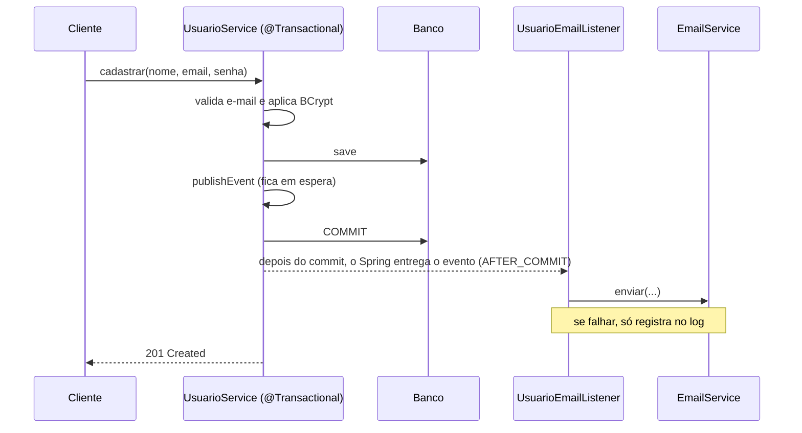

# API de Usuários

API REST de cadastro de usuários feita para o teste técnico de Desenvolvedor Java. Ela cadastra e edita usuários, consulta por id, lista com paginação e filtro opcional por qualquer parte do nome, e exige autenticação com JWT. Ao cadastrar ou editar, o usuário recebe um e-mail, que só é enviado depois que os dados estão gravados.

## Stack

- Java 21, Spring Boot 4.1 (Spring Framework 7), Maven
- Spring Web, Spring Data JPA, Bean Validation
- Spring Security como OAuth2 Resource Server, com JWT assinado em HS256
- Flyway para o schema do banco e H2 em memória
- springdoc-openapi (Swagger UI)
- JUnit 5, Mockito, AssertJ e spring-security-test

## Como rodar

Pré-requisito: **JDK 21**. Se o `java` do seu PATH for de outra versão, aponte o `JAVA_HOME` para um JDK 21 antes de rodar o Maven.

```bash
# PowerShell
$env:JAVA_HOME = "C:\caminho\para\jdk-21"

# Bash
export JAVA_HOME=/caminho/para/jdk-21
```

```bash
./mvnw spring-boot:run      # sobe a API em http://localhost:8080
./mvnw clean verify         # compila e roda todos os testes
```

Não há nada para instalar além do JDK: o banco é o H2 em memória, criado e populado pelo Flyway a cada execução. Por isso os dados somem quando a aplicação reinicia.

**Documentação interativa:** `http://localhost:8080/swagger-ui.html`. Para testar as rotas protegidas por ali, faça o login em `POST /auth/login`, copie o `token`, clique em *Authorize* e cole o token.

**Variáveis de ambiente**

| Variável | Padrão | Para que serve |
|---|---|---|
| `JWT_SECRET` | valor de desenvolvimento | Segredo de assinatura do JWT. Precisa ter pelo menos 32 bytes. **Troque em qualquer ambiente real.** |

A validade do token (1 hora) está em `app.security.jwt.expiration-seconds`.

### Exemplo de uso

```bash
# 1. Cadastro (rota pública). O e-mail de boas-vindas aparece no console da aplicação.
curl -X POST http://localhost:8080/usuarios \
  -H "Content-Type: application/json" \
  -d '{"nome":"Maria Silva","email":"maria@exemplo.com","senha":"senha123"}'

# 2. Login: devolve {"token":"...","tipo":"Bearer","expiraEm":3600}
curl -X POST http://localhost:8080/auth/login \
  -H "Content-Type: application/json" \
  -d '{"email":"maria@exemplo.com","senha":"senha123"}'

# 3. Consulta com o token
curl "http://localhost:8080/usuarios?nome=ria&page=0&size=10" \
  -H "Authorization: Bearer <token>"
```

## Endpoints

| Método e rota | Acesso | Descrição |
|---|---|---|
| `POST /auth/login` | Público | Autentica com e-mail e senha e devolve o JWT |
| `POST /usuarios` | Público | Cadastra um usuário (201 com `Location`) |
| `PUT /usuarios/{id}` | Token | Edita nome, e-mail e, opcionalmente, a senha |
| `GET /usuarios/{id}` | Token | Consulta por id |
| `GET /usuarios?nome=&page=&size=&sort=` | Token | Lista com paginação. `nome` filtra por qualquer parte do nome, sem diferenciar maiúsculas. Padrão: página 0, tamanho 10, ordenada por nome. Máximo: 100 por página; um `size` maior é reduzido a 100, sem erro. |

Os erros seguem o formato `ProblemDetail` (RFC 7807). A validação inclui um campo `erros` com a mensagem de cada campo. Mapeamento: 400 dados inválidos, 401 sem autenticação ou credenciais erradas, 404 usuário inexistente, 409 e-mail já cadastrado.

## Arquitetura

Pacote base `com.example.cadastro_usuario`:

| Pacote | Conteúdo |
|---|---|
| `controller` | `UsuarioController`, `AuthController` e os DTOs, todos records. A entidade e a senha nunca saem pela API. |
| `service` | `UsuarioService` (regras e transação), `EmailService`, o evento `UsuarioSalvoEvent` e o `UsuarioEmailListener` |
| `repository` | `UsuarioRepository` (Spring Data JPA) |
| `domain` | A entidade `Usuario` |
| `security` | Configuração do Resource Server, geração do JWT, `UsuarioDetailsService` e a configuração do OpenAPI |
| `exception` | Exceções de negócio e o `@RestControllerAdvice` que monta os `ProblemDetail` |

### A regra central: o e-mail só sai depois do commit

O enunciado pede que o método que persiste considere o envio do e-mail e seja organizado na ordem mais coerente para garantir atomicidade. A ordem escolhida é gravar primeiro, dentro de uma transação, e enviar o e-mail somente depois do commit.



| Situação | Resultado |
|---|---|
| Falha de validação ou do banco durante a transação | Rollback, o evento é descartado e **nenhum e-mail sai** |
| Falha no envio do e-mail | O erro é capturado e registrado no log. O **cadastro continua gravado** e a resposta é de sucesso |
| Tudo certo | O e-mail sai uma vez, depois do commit |

O `UsuarioService` só publica um evento (`ApplicationEventPublisher`) e não conhece o `EmailService`. O `UsuarioEmailListener`, com `@TransactionalEventListener(phase = AFTER_COMMIT)`, é quem envia. O evento carrega dados simples (id, nome, e-mail, operação), e não a entidade, para não vazar o hash da senha nem depender da sessão do Hibernate depois do commit.

**Limitação conhecida:** se o processo cair entre o commit e o envio, o e-mail se perde. Um sistema real resolveria com o padrão *outbox* (gravar a intenção de enviar na mesma transação e ter um processo que entrega) ou com uma fila.

## Segurança

- **Cadastro e login são públicos.** Todo o resto exige `Authorization: Bearer <token>`. Escolhi o cadastro público para resolver quem cria o primeiro usuário, sem credencial fixa no repositório.
- **JWT HS256**, emitido no login, com validade de 1 hora. O filtro valida a assinatura e a validade sem consultar o banco, e a API é stateless.
- **Senhas com BCrypt.** Só o hash é gravado e ele nunca é devolvido.
- **Login com mensagem única:** e-mail inexistente e senha errada respondem igual ("E-mail ou senha inválidos"), para não revelar quais e-mails existem.
- 401 e 403 também saem como `ProblemDetail`.

**Limitações assumidas:**
- Não há perfis: qualquer usuário autenticado consulta e edita qualquer outro. O enunciado não pede papéis.
- Um token continua válido até expirar, e não há como revogá-lo antes. A API não tem exclusão de usuário, mas, se passasse a ter, o token de um usuário apagado seguiria valendo até o fim da validade. Revogar exigiria refresh token ou uma lista de bloqueio.
- Não há limite de tentativas de login.
- O CORS não está configurado. Um frontend em outra origem precisará disso (veja a seção de frontend).

## Banco de dados

- **Flyway é a única fonte do schema.** A migration `V1__criar_tabela_usuario.sql` cria a tabela, e o Hibernate roda com `ddl-auto=validate`, só conferindo se a entidade bate com o schema. Assim o schema é versionado e revisável.
- **H2 em memória** na aplicação e nos testes, por simplicidade: nada para instalar. Em produção o banco seria outro (PostgreSQL, por exemplo). A migration usa SQL portável, mas essa troca não foi exercitada.
- O e-mail é único em dois níveis: o service checa antes (para dar um 409 com mensagem clara) e a constraint do banco cobre a condição de corrida entre duas requisições simultâneas.
- `open-in-view=false`, para que o acesso lazy não vaze para a camada web.

## Testes

Rodam com `./mvnw test`, todos no H2, sem dependência externa. A motivação foi cobrir cada camada no nível certo e, principalmente, provar a regra central com banco e transação reais, e não só com mocks.

| Classe | Por que existe |
|---|---|
| `UsuarioRepositoryTest` (`@DataJpaTest`) | O filtro por parte do nome (meio do nome, maiúsculas, sem resultado), a paginação, a checagem de e-mail (inclusive "é o próprio usuário"), a constraint única do banco e o preenchimento das datas. Também prova que a entidade e a migration batem. |
| `UsuarioServiceTest` (Mockito) | As regras: cadastro com BCrypt e evento, e-mail duplicado sem gravar nem publicar, edição com e sem senha, e-mail de outro usuário, id inexistente e a listagem com e sem filtro. |
| `UsuarioEmailListenerTest` (Mockito) | O listener envia ao destinatário certo, e uma falha de envio não se propaga. |
| `UsuarioEmailTransacaoTest` (`@SpringBootTest`) | **A regra central, com banco e transação reais:** o commit envia exatamente um e-mail, o rollback não envia nenhum e a falha no envio mantém o usuário gravado. |
| `UsuarioControllerTest` (`@WebMvcTest`) | Status e cabeçalhos de cada endpoint, a senha ausente em todas as respostas, as mensagens de validação por campo e o JSON malformado ou id inválido. |
| `AuthControllerTest` (`@WebMvcTest`) | Login correto, credenciais inválidas com mensagem única e campos ausentes. |
| `TokenServiceTest` | O token traz o e-mail e a expiração, não vale com outro segredo, e um segredo curto é rejeitado na subida. |
| `UsuarioDetailsServiceTest` (Mockito) | Usuário existente devolve o hash, e e-mail inexistente lança a exceção certa. |
| `SegurancaApiTest` (`@SpringBootTest`) | O fluxo completo cadastra, faz login e usa o token. Sem token dá 401, e token adulterado ou expirado também. O cadastro continua público. |
| `DocumentacaoApiTest` (`@SpringBootTest`) | O documento OpenAPI é gerado sem token, declara o Bearer e marca como protegidas só as rotas certas. |
| `CadastroUsuarioApplicationTests` | A aplicação sobe, com Flyway e segurança. |

Os testes seguem o padrão `deveFazerXQuandoY`, com a estrutura given/when/then.

## Possibilidades para o frontend

A API é stateless, usa JWT no cabeçalho `Authorization` e tem um contrato documentado em OpenAPI. Isso serve a qualquer um dos caminhos abaixo.

| Opção | Prós | Contras |
|---|---|---|
| **React** (com TypeScript e Vite) | O maior ecossistema e a maior comunidade, com muitos componentes prontos. Flexível, tem bom suporte a gerar o cliente da API a partir do OpenAPI e é fácil achar gente que conheça. | É uma biblioteca, não um framework: roteamento, formulários e estado exigem escolhas e podem virar inconsistência no time. É mais fácil de bagunçar sem convenções. |
| **Angular** | Framework completo, com roteamento, formulários, cliente HTTP e injeção de dependência incluídos. A estrutura opinativa e o TypeScript combinam com equipes acostumadas ao estilo do Java e do Spring. | Curva de aprendizado maior, mais código de base para um CRUD simples e atualizações de versão trabalhosas. |
| **Vue** | Curva de aprendizado suave, boa documentação e menos código de base. Combina bem com um CRUD pequeno. | Ecossistema e mercado menores que os do React. A escala de times grandes depende mais de disciplina. |
| **Thymeleaf com HTMX** (renderizado no servidor) | Fica no mesmo projeto e na mesma linguagem, sem pipeline de Node nem CORS. Para um CRUD simples é o caminho mais curto. | Menos adequado para interfaces muito interativas. Acopla o frontend ao backend e, para esta API, o JWT teria de ser tratado no servidor ou trocado por sessão. |

**Recomendação:** para uma tela administrativa de CRUD, que é o escopo aqui, eu usaria **React com TypeScript**, gerando o cliente da API a partir do `/v3/api-docs`. Se a equipe for majoritariamente de backend Java e valorizar estrutura imposta, o **Angular** é a alternativa. O Thymeleaf com HTMX só valeria se a interface fosse muito simples e não houvesse intenção de reaproveitar a API em outros clientes.

**Pontos de atenção em qualquer SPA:**
- **CORS:** a API ainda não o configura. Um frontend em outra origem precisa de uma configuração explícita.
- **Onde guardar o token:** o `localStorage` é simples, mas fica exposto a XSS. Cookie `HttpOnly` evita isso, mas traz CSRF e exigiria mudar a API. Em memória é mais seguro, mas se perde ao recarregar a página. Com a validade curta de 1 hora, um refresh token seria o próximo passo natural.

## Decisões e próximos passos

Decisões principais (detalhadas nas seções acima): e-mail depois do commit por evento, Flyway com `validate`, e-mail único em dois níveis, cadastro público com JWT para o resto, DTOs sem a senha, erros em `ProblemDetail`.

Não foi feito, por estar fora do enunciado:
- Envio real de e-mail (o `EmailService` só imprime no console).
- Outbox ou fila para entrega garantida do e-mail.
- Refresh token, revogação de token e limite de tentativas de login.
- Perfis de acesso e restrição de cada usuário à própria conta.
- Banco persistente e configuração por ambiente.
- Configuração de CORS.
